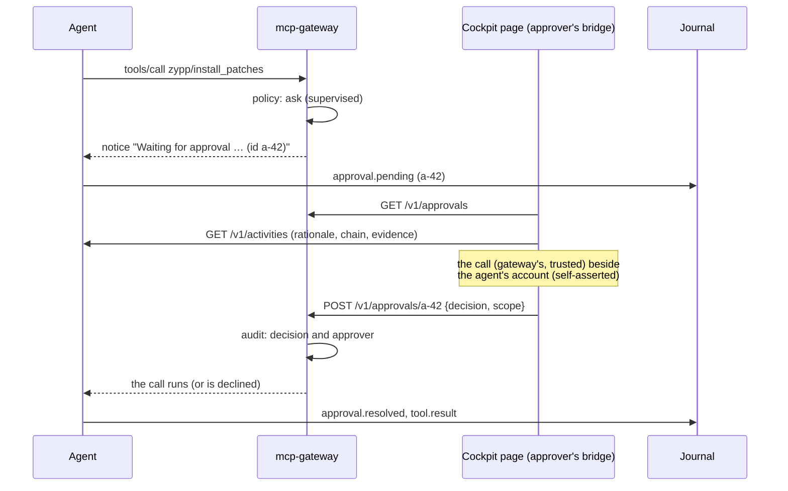

# User flow

> For using the page, see the user guide,
> [chapter 8](user-guide/08-cockpit.md). This document is the design
> behind it.

How people use Custos from Cockpit: who logs in, what each person
can see and do, and what happens behind each action, in the Cockpit page
(`custos-cockpit`; [screenshots](screenshots/README.md)). Each step names
the interface the page uses.
[CONTRACT.md](../CONTRACT.md) is the reference for every interface named
here.

## Who logs in

Everyone logs in to Cockpit with **their own account**: a local user, or a
directory account (sssd, IPA, AD) that resolves to one. Cockpit runs a
bridge process as that account, and everything the page does goes through
it, so every agent socket and mcp-gateway itself see the person.

Not for logging in:

- **`mcp-gateway`**: the gateway's system account, without a login. It
  only owns the daemon; the gateway identifies the people who connect to
  it by their peer credentials (`SO_PEERCRED`).
- **`agent-<name>`**: the agents' system accounts, without passwords.
- **root**: works for the administrative actions, but every approval made
  as root is recorded as root's, and who decided is lost. Use your own
  account with *Administrative access* instead.

## Roles

| Role | Account needs | Can |
|---|---|---|
| **Viewer / chat user** | membership in `agent-clients` | see agents and activities, chat with an agent (as themselves) |
| **Approver** | the above, and a binding in mcp-gateway's approver rules (a role or a group of people, e.g. `approvers: {zypp: ['role:admin', 'group:patch-approvers']}`; never `agent-clients` or `mcp-users`, which every agent is in) | decide pending calls, revoke grants |
| **Administrator** | the above, and sudo rights (e.g. `wheel`), for Cockpit's *Administrative access* | create and remove agents, set modes and permissions, pause, cancel, stop all |

An approver need not be an administrator, and an administrator decides
approvals only where the approver rules name them.

## Two sessions in one page

With *Administrative access* off, the page has one bridge: the person's.
With it on, Cockpit adds a root bridge. The page uses each for one kind
of action:

| Action | Bridge | Why |
|---|---|---|
| Approve, decline, revoke a grant | **the person's**, always | mcp-gateway records the approver it sees; as root, the record would say root |
| Read status, activities, journal; chat | the person's | the agents' sockets and the journal answer as the person is allowed |
| Pause, resume, cancel, stop all, release all, mode, permissions, create, delete | **root** | only root may change agent data and units; `agent-admin` records the person in its `by:` and the journal |

So *Administrative access* never changes who an approval is recorded for.
CONTRACT.md §2 (*People and the control plane*) makes this a rule for any
control plane.

## 1. Setting up (administrator, once)

1. Install `custos` (and `custos-selinux` where SELinux runs) next
   to `mcp-gateway`.
2. Add the people who supervise agents to `agent-clients`.
3. Name the approvers of the gateway servers the agents use, in
   mcp-gateway's approver rules.
4. Create an agent: *Create agent* on the Agents tab, or
   `agent-admin create NAME --from agent.yaml`. It starts
   **supervised** and with **no permissions**: it can do nothing yet.
5. List what it may do: `agent-admin permissions NAME < list.yaml`
   (read-only permissions say `read_only: true`; everything else needs
   an approval in supervised mode).
6. For an agent in an OpenShell sandbox, set its credential:
   `agent-admin set-credential NAME gateway-client-secret < secret` (or a
   static `gateway-token`), which creates the sandbox.

In Cockpit these are the *Agents* and *Policy* tabs, with *Administrative
access*.

## 2. Watching (everyone)

The **Activity** tab lists what the agents do: running activities first,
each with its origin (schedule, event, chat, API, delegation) and, for a
delegated one, its chain back to the origin. Selecting one shows its tool
calls and their states. The summary cards count what runs, what waits for
an approval, the next scheduled run, and what ended in the last day.

Behind it: `GET /v1/status` and `GET /v1/activities` on each agent's
socket, `/run/agents/<name>/api.sock` (CONTRACT.md §4, §5).

## 3. Approving (approver)

1. A call that changes the system waits. The **Approvals** tab shows it
   with a counter in the tab, and the gateway can also notify by desktop
   notification, mail or webhook (mcp-gateway's `oob` channel).
2. The item has two halves. **The call, from mcp-gateway**: server, tool,
   exact arguments, the agent's principal, the policy that asked, who may
   decide. **The agent's account**, marked self-asserted: its stated
   reason and impact, who started the activity, the delegation chain, the
   evidence from its earlier calls. Only the first half is trustworthy.
3. The approver chooses **Approve once**, **Approve for 1 h** (a grant in
   mcp-gateway, revocable), or **Decline**. The decision goes to the
   gateway as the approver, through their own bridge.
4. The call returns to the agent; the activity goes on or reports the
   decline. The gateway's audit and the journal record the decision and
   who made it.

An agent cannot approve its own calls: agents have no password and cannot
reach the gateway's control socket.

## 4. Intervening (administrator)

| Control | In the page | What happens |
|---|---|---|
| **Cancel** | *Cancel activity* on an activity | the agent ends that activity (`POST /v1/activities/{id}/cancel`) |
| **Pause / resume** | on an agent | the gateway denies its calls and the agent holds its activities (`agent-admin pause`, `resume`) |
| **Revoke a grant** | on the Approvals tab | the gateway forgets an *Approve for 1 h* (approvers may do this too) |
| **Emergency stop** | *Stop all agents* in the header | the gateway denies every agent everything, then every agent and schedule is stopped (`agent-admin stop-all`); *Release…* undoes it (`release-all`) |

Pause and the emergency stop are enforced by the gateway and by systemd
(or OpenShell), not by the agents: they work even if an agent ignores them.
`agent-admin` returns once the gateway's policy has the change in force.

## 5. Changing what an agent may do (administrator)

The **Agents** and **Policy** tabs show each agent's autonomy mode and
permissions, read from its gateway agent data
(`/etc/mcp-gateway/policy/agents/<name>.yaml`):

- **advisory**: only read-only permissions;
- **supervised** (default): read-only permissions run, the others wait for
  an approval;
- **bounded**: also the permissions marked `autonomous` run without one.

Changing the mode or the permissions runs `agent-admin mode` or
`agent-admin permissions` (root bridge); the gateway enforces the change
within seconds and `agent-admin` waits until it does.

## 6. Chatting (everyone in `agent-clients`)

A person chats with an agent as themselves: the agent's socket identifies
them, the conversation is theirs (another user's thread is not visible to
them), and the activity's origin is `chat · <user>`. What the agent may do
in a chat is the same as always: its permissions and mode, and approvals
for what changes the system. The page talks AG-UI over the socket
(`POST /agui`, CONTRACT.md §11) and shows approvals inline.

## 7. Reviewing (everyone; audit for administrators)

The **Audit** tab joins the agents' journal records (`AGENT_*` fields:
activities, tool calls, approvals, interventions; CONTRACT.md §10) with
mcp-gateway's audit (every call with its policy decision and, for an
approval, the approver). The journal answers as Cockpit's Logs page does,
so what a person sees depends on their journal access.
